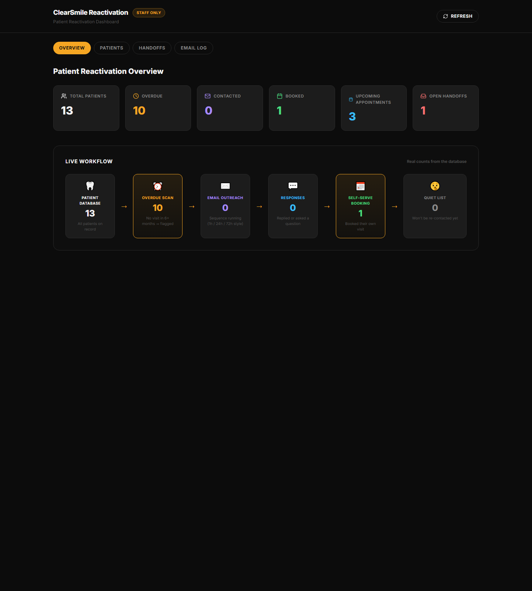

# ClearSmile Patient Reactivation System

A trigger-based **patient reactivation system** for a dental clinic. It finds patients who
haven't visited in 6+ months, works them through a gentle follow-up email sequence, lets them
book their return visit online, catches no-shows, and routes patient questions to a staff
handoff queue — all controlled from a single professional admin dashboard.

> **Build-in-public:** a real project built and shipped publicly over 30 days, from brief to live
> deployment, with clean, client-ready code and onboarding docs.

---

## Screenshot



*The admin dashboard — patient reactivation funnel, priority follow-up list, and recent email
activity.*

> **Note for maintainers:** add a current screenshot of *your* live dashboard at
> `docs/dashboard.png` (the repo currently ignores `docs/` for internal build materials; when you
> add a README screenshot, un-ignore that one file with `!docs/dashboard.png` in `.gitignore`).
> See the bottom of this file for how to re-seed demo data so the dashboard looks fully populated.

---

## Overview

Dental clinics silently lose a meaningful share of their patient list every year: no systematic
reminder, no re-engagement, appointment gaps go unfilled. This system automates the entire
reactivation funnel so staff can watch every patient move through the pipeline and respond in
real time.

**The patient journey the system automates:**

```
no visit → 6+ months
        ↓  (overdue scan)
   none   →   overdue   →   contacted   →   responded   →   booked
                (day 0)     (day 7)        (day 14)        ↓
                                                     attended / no-show recovery
                                                            ↓
                                                       rescheduled
```

Every patient is tracked against one status, from "overdue" to "booked" to "suppressed"
(opted-out or recently contacted). The dashboard shows the whole funnel at a glance.

---

## Features

- **Overdue scan** — flags any patient with no visit in 6+ months, automatically suppressing
  recently-contacted and opted-out patients.
- **Reactivation email sequence** — follows up the flagged list on **day 0 / day 7 / day 14**,
  with real deliverability through Resend SMTP.
- **Self-serve booking** — a responding patient picks a real, available slot and books directly.
- **Booking confirmation & reminders** — confirms the appointment and reminds the day before.
- **No-show recovery** — flags missed appointments so staff can reschedule them.
- **Staff handoff queue** — patient questions route to the front desk as actionable items.
- **Admin dashboard** — a professional operations view: stat cards, a conversion funnel, a
  priority follow-up list and recent-email activity, all backed by real data.

---

## Tech Stack

| Layer          | Technology                                             |
| -------------- | ------------------------------------------------------ |
| Frontend       | React 19 · TypeScript · Vite · Tailwind CSS            |
| Backend        | Vercel serverless functions (Node.js TypeScript)       |
| Database       | InsForge (Postgres BaaS, hosted PostgREST)             |
| Email          | Resend (SMTP)                                          |
| Booking        | Custom self-serve slot engine + webhook API            |
| Deployment     | Vercel (frontend + serverless API)                     |

---

## Architecture

```
Browser (React SPA)
   │  /book  ·  /admin
   ▼
Vercel Serverless Functions
   ├── /api/admin   → dashboard, patients, handoffs, email logs, demo seed
   ├── /api/booking → available slots
   ├── /api/webhook → booking confirmation, staff handoff, patient import
   └── /api/cron    → overdue scan, follow-ups, reminders, no-show recovery
   ▼
InsForge Postgres (PostgREST)
   ├── patient       (status pipeline + flagged_at)
   ├── appointment   (booked/confirmed/attended/no_show)
   ├── followup      (which sequence steps are done per patient)
   ├── emaillog      (every outgoing email + delivery status)
   └── staffhandoff  (open patient questions for the front desk)
```

The schema is defined in [`migrations/20260901000000_create-tables.sql`](migrations/20260901000000_create-tables.sql).

---

## Quick Start (local development)

> Full, copy-paste onboarding: see **[ONBOARDING.md](ONBOARDING.md)**.

```bash
# 1. Clone
git clone https://github.com/comfortokonfriday15-web/clearsmile-patient-reactivation.git
cd clearsmile-patient-reactivation

# 2. Install
npm install

# 3. Configure environment
cp .env.example .env.local
# then fill in your InsForge + Resend/email values in .env.local

# 4. Run
npm run dev
# → http://localhost:3000  (app)
```

---

## Environment Variables

All configuration lives in environment variables. A template ships as `.env.example`.
**Never commit your real keys** — `.env.local` is git-ignored.

| Variable                | Description                                     | Example                       |
| ----------------------- | ----------------------------------------------- | ----------------------------- |
| `INSFORGE_URL`          | InsForge/PostgREST base URL                     | `https://<proj>.insforge.app` |
| `INSFORGE_API_KEY`      | InsForge admin API key                          | `ik_...`                      |
| `SMTP_HOST`             | SMTP host for email                             | `smtp.resend.com`             |
| `SMTP_PORT`             | SMTP port (`465` = SSL)                         | `465`                         |
| `SMTP_USER`             | SMTP username                                   | `resend`                      |
| `SMTP_PASS`             | SMTP password / API key                         | `re_...`                      |
| `EMAIL_FROM`            | Sender address                                  | `onboarding@resend.dev`       |
| `EMAIL_LIVE`            | `"true"` to actually send mail (safety guard)   | `false` (default)             |
| `MAX_EMAILS_PER_RUN`    | Max emails per unique recipient per run         | `5`                           |
| `BOOKING_URL_BASE`      | Public booking URL used in emails               | `https://<app>.vercel.app/book` |
| `OVERDUE_MONTHS`        | Months without a visit before flagging          | `6`                           |
| `SUPPRESSION_DAYS`      | Days since last contact to suppress re-contact  | `90`                          |
| `FOLLOWUP_DAYS`         | Sequence day offsets (comma-separated)          | `0,7,14`                      |
| `CLINIC_NAME/ADDRESS/CITY/PHONE` | Clinic identity used in emails            |                               |
| `BUSINESS_HOURS_*`      | Operating hours for the booking slot engine     | `8`–`18`, Sat `9`–`16`        |
| `SEED_ENABLED`          | `"true"` enables the demo seed endpoint         | `false`                       |
| `CRON_SECRET`           | Secret header auth for cron endpoints           |                               |

> **Email safety guard:** outbound email is **opt-in**. Real sends only happen when
> `EMAIL_LIVE=true`; otherwise the system logs you'd send but never transmits. Each run is also
> capped per recipient (`MAX_EMAILS_PER_RUN`) to prevent any accidental burst.

---

## Deployment (Vercel)

1. **Frontend + API:** import the repo into Vercel; the build is handled automatically
   (`npm run build`), with serverless functions from `/api`.
2. **Set environment variables** in Vercel (Production) — same list as above.
3. **Database:** run the schema migration against your InsForge project.
4. **Seed demo data (optional):** set `SEED_ENABLED=true`, call `POST /api/admin/seed-demo`,
   then set `SEED_ENABLED=false` again.
5. **Enable email (optional, for live sends):** set `SMTP_*` + `EMAIL_LIVE=true`.
6. **Crons (optional):** hit `/api/cron/run?type=...` with the `x-cron-secret` header on your
   schedule. The four jobs: `scan-overdue`, `process-followups`, `send-reminders`, `handle-no-shows`.

---

## API Reference

| Method | Endpoint                    | Purpose                                   |
| ------ | --------------------------- | ----------------------------------------- |
| GET    | `/api/admin/dashboard`      | Funnel counts, totals, recent activity    |
| GET    | `/api/admin/patients`       | Paginated patient list (optional `status`)|
| GET    | `/api/admin/emaillogs`      | Outgoing email log                        |
| GET    | `/api/admin/handoffs`       | Open staff handoffs; PATCH to mark handled|
| GET    | `/api/booking/slots`        | Available appointment slots (14 days)     |
| POST   | `/api/webhook/booking`      | Create booking (patient + appointment)    |
| POST   | `/api/webhook/handoff`      | Route a patient question to front desk    |
| POST   | `/api/webhook/patient`      | Bulk-import patients for seeding          |
| POST   | `/api/admin/seed-demo`      | Seed realistic demo data                  |
| POST   | `/api/cron/run`             | Run a scheduled job (`?type=...`)         |

---

## Project Structure

```
.
├── api/                    # Vercel serverless functions
│   ├── admin/              # dashboard, patients, handoffs, logs, seed
│   ├── booking/            # slot availability
│   ├── cron/               # scheduled jobs
│   └── webhook/            # booking, handoff, import
├── migrations/             # SQL schema
├── src/
│   ├── components/         # React UI (AdminApp, BookingApp, ui)
│   ├── lib/                # insforge client, email, config, reactivation logic
│   ├── App.tsx             # client-side routing
│   └── main.tsx
├── .env.example            # env template (safe to commit)
├── vercel.json             # routing + function config
└── BRIEF.md                # project brief
```

---

## License

[MIT](LICENSE)